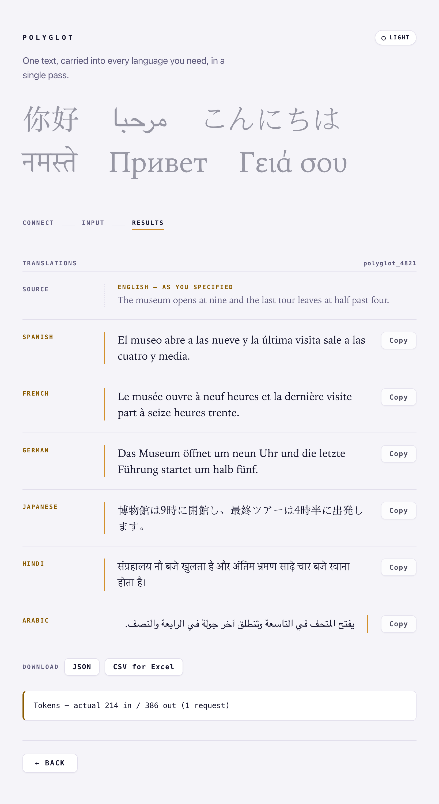
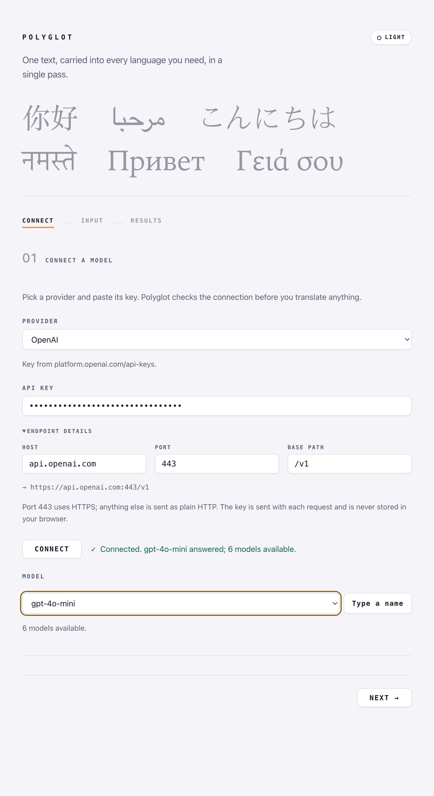
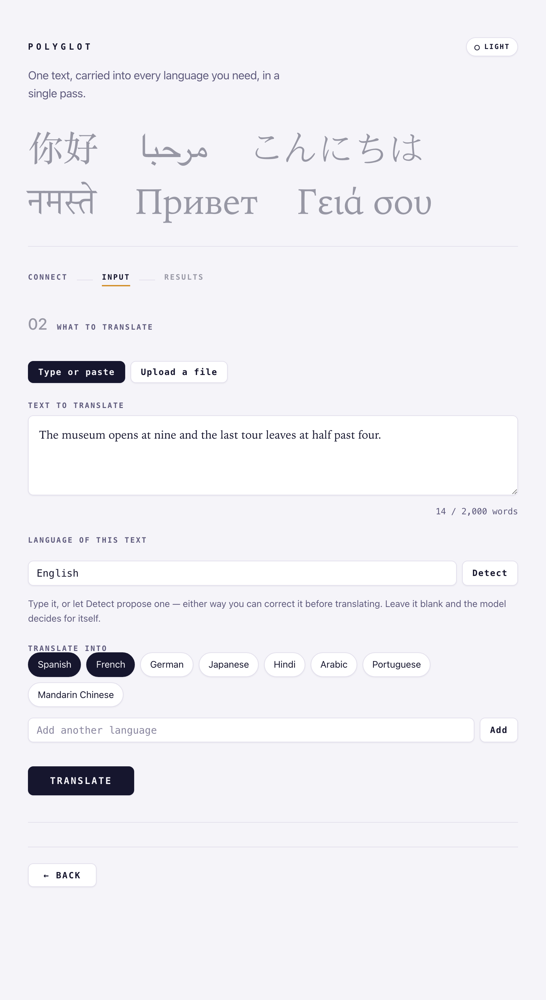
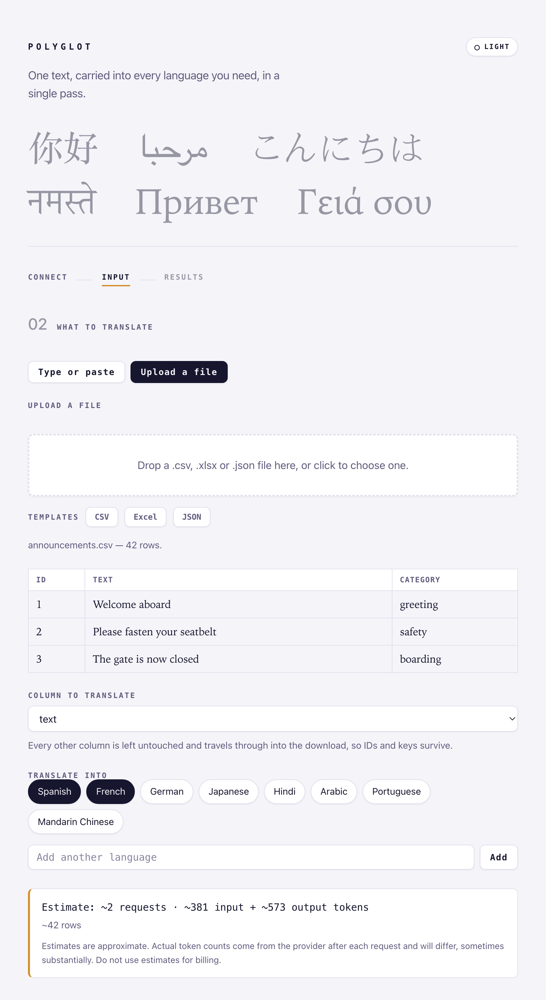
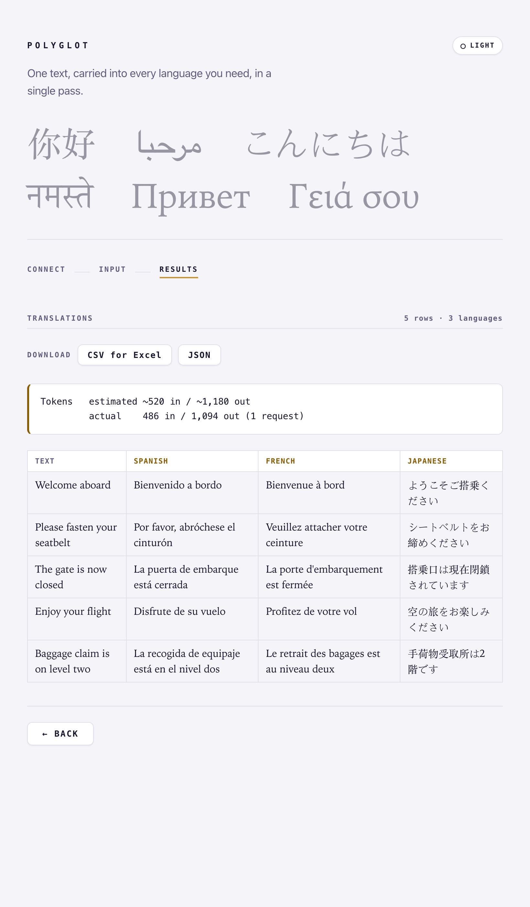
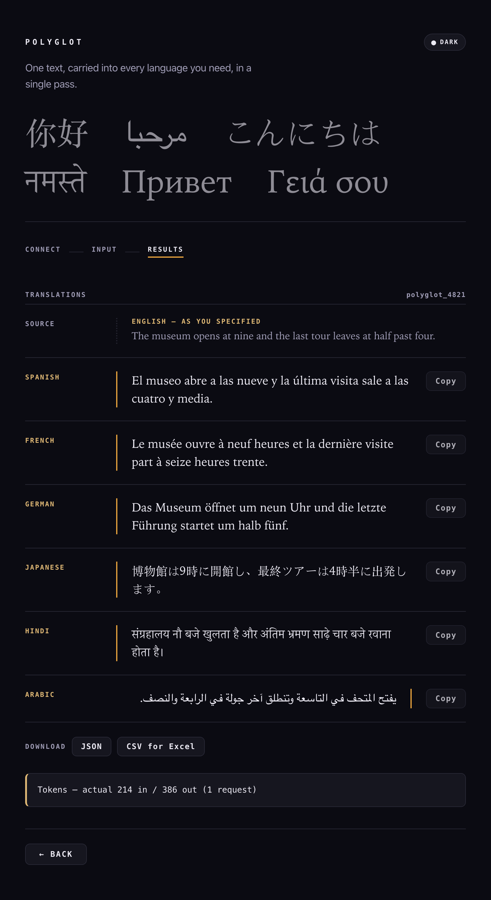

<div align="center">

# Polyglot

### One text, carried into every language you need — in a single pass.

A local-first web app and [MCP](https://modelcontextprotocol.io) server that translates text into
many languages at once, through any OpenAI-compatible model — your local Ollama, or a hosted
provider you bring a key for.

[](https://www.python.org/)
[](https://fastapi.tiangolo.com/)
[](https://modelcontextprotocol.io)
[](LICENSE)



</div>

---

## Why Polyglot

Most translation tools give you one target language at a time, and send your text to a service you
don't control. Polyglot does the opposite:

- **Local-first.** It runs on your machine and talks to a local Ollama by default. Nothing leaves
  your network unless you point it at a hosted provider yourself.
- **One pass, many languages.** Type a sentence, tick the languages you want, and read them all back
  side by side against one margin rule — including right-to-left scripts.
- **Bring any OpenAI-compatible model.** Local Ollama, Ollama Cloud, OpenAI, Gemini, xAI, DeepSeek,
  Mistral, Groq, or a custom endpoint. The connection is checked before you translate anything.
- **Batch a whole file.** Upload a CSV, Excel, or JSON file and translate one column; every other
  column travels through untouched. You see a token-cost estimate *before* you spend.
- **Also an MCP server.** Every endpoint is exposed as a tool at `/mcp`, so an AI assistant can
  translate, detect a language, or batch a file on your behalf.
- **Light and dark.** The single-page UI follows your OS, or you can pick a side.

---

## Features

### Connect a model, then verify before you spend

Pick a provider and paste a key. Polyglot fills in the endpoint, checks that the key works, and
lists the models it can actually see — so a wrong model or a stale key fails here, not mid-translation.



### Type or paste, in one pass into many languages

A word counter keeps you under the limit, language chips make the common targets one click, and
you can add any language by name. Let the model identify the source language, or name it yourself.



The results are laid out as a parallel-text register, each language against a continuous margin
rule, with one-click copy and JSON / CSV download.

### Upload a file and batch-translate a column

Drop in a `.csv`, `.xlsx`, or `.json` file (templates provided). Polyglot previews it, suggests the
text column, and shows a live estimate of requests and tokens before you commit.



The output is a table you can download as CSV or JSON, with the estimate set beside the actual
tokens the provider reported.



### Light and dark



---

## Quickstart

Polyglot is built and run with [uv](https://docs.astral.sh/uv/).

```bash
# 1. Install dependencies into a managed virtual environment
uv sync

# 2. Start the app (binds 127.0.0.1:8000 with reload)
uv run polyglot

# 3. Open the UI
open http://127.0.0.1:8000
```

`uv run polyglot` is the entry point defined in `pyproject.toml`. If you'd rather drive uvicorn
directly — for example to change the bind address — the app object is `polyglot.app.main:app`:

```bash
uv run uvicorn polyglot.app.main:app --reload
```

### Talking to a local Ollama

The defaults point at a local Ollama on `localhost:11434`. Have it running with a model pulled:

```bash
ollama serve
ollama pull gpt-oss:20b
```

Then open the app, keep the **Ollama (local)** provider, and click **Connect**. No key required.

### Using a hosted provider

Pick your provider in the UI, paste its key, and connect. Nothing is stored in your browser — the
key is sent with each request and never persisted. See the [providers](#providers) table below for
where each key comes from.

---

## Providers

The UI ships with presets so you only have to supply a key. Every hosted provider is TLS on port
443; the model shown is a sensible default and stays editable — `/verify` lists what your key can
actually see.

| Provider | Host | Base path | Default model | Key needed |
|----------|------|-----------|---------------|:----------:|
| Ollama (local) | `localhost:11434` | `/v1` | `gpt-oss:20b` | No |
| Ollama Cloud | `ollama.com` | `/v1` | `gpt-oss:120b` | Yes — [ollama.com/settings/keys](https://ollama.com/settings/keys) |
| OpenAI | `api.openai.com` | `/v1` | `gpt-4o-mini` | Yes — [platform.openai.com/api-keys](https://platform.openai.com/api-keys) |
| Google Gemini | `generativelanguage.googleapis.com` | `/v1beta/openai` | `gemini-2.5-flash` | Yes — [aistudio.google.com/apikey](https://aistudio.google.com/apikey) |
| xAI (Grok) | `api.x.ai` | `/v1` | `grok-4-fast` | Yes — [console.x.ai](https://console.x.ai) |
| DeepSeek | `api.deepseek.com` | `/v1` | `deepseek-chat` | Yes — [platform.deepseek.com](https://platform.deepseek.com) |
| Mistral | `api.mistral.ai` | `/v1` | `mistral-small-latest` | Yes — [console.mistral.ai](https://console.mistral.ai) |
| Groq | `api.groq.com` | `/openai/v1` | `llama-3.3-70b-versatile` | Yes — [console.groq.com/keys](https://console.groq.com/keys) |
| Custom | *(you fill it in)* | `/v1` | *(you fill it in)* | Optional |

Adding a provider is a five-field edit to `PROVIDERS` in `src/polyglot/constants/constants.py` — not
a code change.

---

## File / batch translation

Upload a `.csv`, `.xlsx`, or `.json` file and translate a single column. Every other column passes
through untouched into the download, so IDs and keys survive.

- **Row limit:** up to **200 rows** per file.
- **Word limit (single text):** up to **2,000 words** for the type-or-paste mode.
- **Dedupe:** identical cells are translated once, then mapped back onto every matching row.
- **Batching:** rows are sent in chunks of 25 across up to 4 parallel requests.
- **Cost estimate:** before you translate, Polyglot estimates the number of requests and the input
  and output tokens. Estimates are approximate — actual counts come from the provider after each
  request and can differ substantially, so don't use them for billing. The results screen shows the
  estimate and the actual side by side.

Download starter files from the UI, or straight from the API: `/template.csv`, `/template.xlsx`,
`/template.json`.

---

## MCP server

Polyglot mounts a [Model Context Protocol](https://modelcontextprotocol.io) server at **`/mcp`**
(via [`fastapi-mcp`](https://github.com/tadata-org/fastapi_mcp)). Each API endpoint carries an
`operation_id` and is exposed as an MCP tool, so an MCP-capable assistant can verify a connection,
detect a language, translate text, and batch-translate a file — the same operations the UI performs.

Point your MCP client at `http://127.0.0.1:8000/mcp` while the app is running.

---

## API reference

The app object is `polyglot.app.main:app`. Interactive docs are served at `/docs`.

| Method | Path | `operation_id` | Purpose |
|--------|------|----------------|---------|
| GET | `/` | — | The single-page translation UI |
| GET | `/config` | `config` | Configured defaults + provider presets (never returns the key) |
| POST | `/verify` | `verify` | Check an endpoint answers and the key works; lists available models |
| POST | `/detect` | `detect` | Identify the language of a piece of text |
| POST | `/translate` | `translate` | Translate one text into many languages |
| POST | `/upload` | `upload` | Parse an uploaded file and return its structure (no translation) |
| POST | `/translate-file` | `translate_file` | Batch-translate a column of an uploaded file |
| GET | `/template.{csv,xlsx,json}` | `template` | Download a starter file for batch translation |
| — | `/mcp` | — | MCP server mount |

Example — translate one sentence into three languages:

```bash
curl -X POST http://127.0.0.1:8000/translate \
  -H "Content-Type: application/json" \
  -d '{
    "text": "The museum opens at nine.",
    "target_languages": ["Spanish", "French", "Japanese"]
  }'
```

Connection fields (`host`, `port`, `path`, `model`, `api_key`) can be included in the body to
override the configured defaults per request.

---

## Configuration

Defaults live in `src/polyglot/constants/constants.py` and can be overridden with environment
variables. Copy `.env.example` to `.env.local` (gitignored) and load it with
`uv run --env-file .env.local polyglot`.

| Variable | Default | Purpose |
|----------|---------|---------|
| `POLYGLOT_HOST` | `localhost` | LLM endpoint host |
| `POLYGLOT_PORT` | `11434` | LLM endpoint port (443 uses HTTPS; anything else is plain HTTP) |
| `POLYGLOT_MODEL` | `gpt-oss:20b` | Default model |
| `POLYGLOT_PATH` | `/v1` | Base path the OpenAI-compatible API is served under |
| `POLYGLOT_API_KEY` | *(empty)* | API key, read from the environment so it never lives in a committed file |

> **A note on network exposure.** The server binds loopback (`127.0.0.1`) by default. Because
> `/translate` accepts caller-supplied connection details, a server reachable from the network lets
> anyone on it aim requests at arbitrary addresses. Only bind `0.0.0.0` on a network you trust. See
> [SECURITY.md](SECURITY.md) for the full note.

---

## Development

```bash
uv sync          # install, including the dev group
uv run pytest    # run the test suite
```

---

## Contributing & conduct

Contributions are welcome. Please read [CONTRIBUTING.md](CONTRIBUTING.md) and the
[Code of Conduct](CODE_OF_CONDUCT.md) before opening a pull request, and
[SECURITY.md](SECURITY.md) if you're reporting a vulnerability.

## License

Licensed under the [Apache License 2.0](LICENSE).
